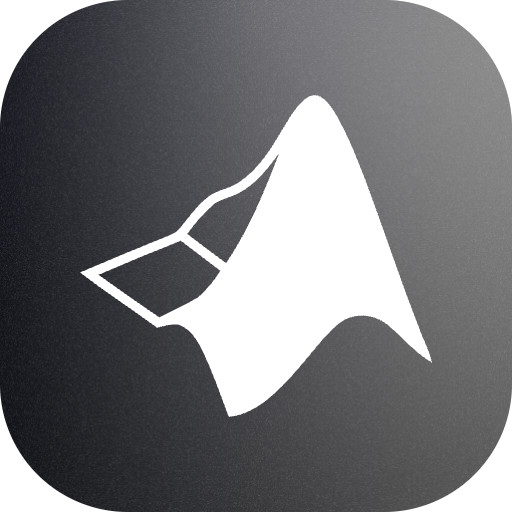
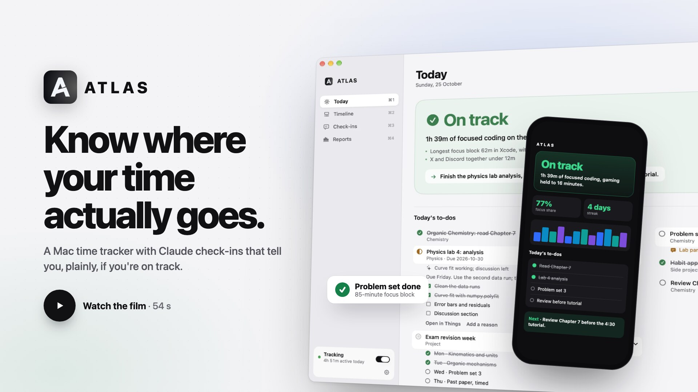
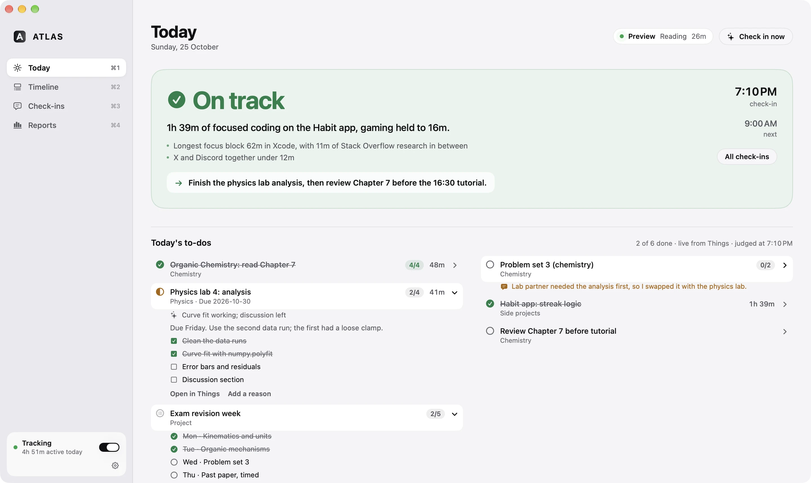

<p align="center">
  
</p>

<h1 align="center">ATLAS</h1>

<p align="center">
  <strong>Know where your time actually goes.</strong><br>
  A quiet, local-first activity tracker for macOS, with scheduled Claude check-ins.
</p>

<p align="center">
  <a href="https://atlasmac.web.app/">Website</a> ·
  <a href="#install">Install</a> ·
  <a href="#claude-check-ins-the-part-after-tracking">Claude check-ins</a> ·
  <a href="#privacy--data">Privacy</a>
</p>

<p align="center">
  
  
  
</p>

<p align="center">
  <a href="https://atlasmac.web.app/#film"></a><br>
  <sub>Watch the 48-second film · <a href="docs/assets/atlas-promo.mp4">MP4</a></sub>
</p>

<p align="center">
  
</p>

---


A local-first macOS activity tracker. ATLAS **only tracks**; it does not plan. Feedback comes from a scheduled
Claude check-in that reads ATLAS through its MCP server and compares what you actually did with your calendar and
your Daily Briefing (see **Claude check-ins** below).
The tracker records how you spend time on your Mac. After every N hours of *awake* time it sends one minimized,
privacy-filtered summary to Claude, through **your Claude subscription via Claude Code**. No API credits are needed. Claude compares what you planned with what you did and proposes a realistic
next block. Calendar changes go through an explicit authorization policy.

- Swift 6 / SwiftUI, macOS 14+, native on Apple Silicon. No third-party dependencies (system SQLite, URLSession, EventKit).
- 56 deterministic XCTest cases (plus one opt-in live check) cover the 27 acceptance scenarios and more: `swift test`.

## Install

**[Download ATLAS for Mac](https://github.com/ZahinTapadar/atlas/releases/latest/download/ATLAS.dmg)** (free, about 9 MB, macOS 14+, Apple Silicon and Intel), or with Homebrew:

```bash
brew install --cask zahintapadar/tap/atlas
```

ATLAS isn't notarized by Apple yet, so macOS blocks the first launch: open **System Settings → Privacy & Security**,
scroll down and click **Open Anyway** next to "ATLAS was blocked". You only do this once.

On first launch a **setup checklist** walks through everything, each step with its live status and one button:

- **Tracking:** Accessibility (window titles), Chrome tabs, Calendar, Notifications.
- **Claude check-ins:** Claude Code signed in with a Claude subscription; **Connect** (registers the `atlas` MCP
  server); **Check-in schedule** copies a request you paste into the Claude app, which creates the scheduled task
  (9, 12, 15, 18 and 21) and runs a first check-in.
- **Email:** where check-ins go. Gmail and iCloud addresses can add an app password for the designed email
  (scorecard, animated charts, to-dos); otherwise check-ins arrive as plain text through Mail.
- **Optional:** Things 3, the Chrome extension, a calendar connector in Claude.

Today shows a reminder until the essential steps are done; the checklist reopens from **Settings → Permissions & setup…**.

**When check-ins happen is set in ATLAS** (Settings → Check-ins): pick the days and hours (6 AM–11 PM), pause
for a day or a week, skip just the next one, or run a full check-in now. The Claude task wakes every hour
and first asks ATLAS (`should_check_in`); hours you didn't choose stop there after one quick call.

**Updates install themselves.** Release builds check GitHub on launch and every few hours and offer new
versions in the sidebar. An update is installed only if its SHA-256 matches and its code signature comes
from the pinned ATLAS Release certificate, which also keeps macOS permissions across versions. Homebrew
installs update the same way (the cask is marked `auto_updates`).

Releases are built from this repository by [`.github/workflows/release.yml`](.github/workflows/release.yml) when a
`v*` tag is pushed (`scripts/package-release.sh` makes the universal disk image).

## Build & run

```bash
swift test                    # core logic, fixtures only; no real usage needed
./scripts/build-app.sh        # build, sign, install ~/Applications/ATLAS.app, link atlasctl, register the MCP server
open ~/Applications/ATLAS.app
```

On first launch a **setup screen** requests every permission (Window titles/Accessibility, Chrome tabs/Automation,
the optional Chrome extension, Calendar, Notifications). It reopens from **Fix permissions…** on the dashboard or
from Settings → General. The build signs with your "Apple Development" certificate when one is present: macOS ties
permission grants to the signing identity, so ad-hoc builds would lose them on every rebuild. The entitlements in
`Resources/ATLAS.entitlements` are required; under the hardened runtime, Calendar and Apple Events requests are
refused silently without them.

## Claude check-ins (the part after tracking)

- `atlasctl` (installed to `~/.local/bin`) prints summaries: `atlasctl today`, `atlasctl summary --from -3h --json --timeline`, `atlasctl now`.
- `atlasctl mcp` is an MCP server registered for Claude at user scope as **`atlas`**. Tools:
  `get_activity_summary`, `get_current_activity`, `get_recent_checkins`, and `record_checkin`, which writes
  feedback back into ATLAS. The data uses the same privacy filtering as everything else.
- The scheduled task **ATLAS Check-in** (Claude app → Scheduled; `~/.claude/scheduled-tasks/atlas-checkin/SKILL.md`)
  runs at 9:00, 12:00, 15:00, 18:00 and 21:00. Each run reads ATLAS, your Google Calendar, and that day's output
  of your existing **Daily Briefing** routine, then gives a verdict (on track / mixed / off track) with minutes and
  next steps. The verdict is saved into ATLAS's Agent panel and dashboard.
- Each check-in closes the loop. It checks off Things to-dos that the evidence clearly shows finished, and notes partial progress. It adds `Did ·` blocks to Google Calendar for what you actually did, plus a `Next ·` block with a reminder. It emails you the verdict (to the address in Settings → Claude, sent through Mail) and shows it on the Today screen alongside today's to-dos. It also sends a push notification when Remote Control is connected.
- Automatic in-app analysis of each 3-hour window is off by default, to avoid spending your plan twice.
  **Analyze Now** still works.

Use the bundled app, not `swift run`, for daily use: notifications, Calendar prompts and launch-at-login need a real bundle.
Then:
1. Install [Claude Code](https://code.claude.com/docs) and run `claude auth login`, choosing your Claude (Pro/Max)
   account rather than Console billing. **Settings → Claude** should show "Claude subscription ✓".
2. **General** → grant Accessibility (optional) so window titles can be read.
3. **Calendar** → connect Apple Calendar and choose an authorization level.
4. **Browser** → install the extension (below) and/or enable Safari automation.

### Browser tabs (Chrome and other Chromium browsers, Safari)
macOS cannot see browser tabs on its own. ATLAS has two sources:
1. **Automation (works immediately):** while a browser is frontmost, ATLAS asks it for the front tab's URL and title
   every 10 s. macOS asks permission once per browser.
2. **Extension (optional, more precise):** event-driven, and reports audio and incognito. The extension has a fixed
   ID (`llolohdkomppidilbbmkmoognfcgoheh`), so ATLAS registers its native-messaging helper automatically. Chrome
   still requires loading it once by hand: setup screen → Install… → Developer mode → **Load unpacked** →
   the highlighted `chromium` folder.

Chrome "installed apps" (X, YouTube, Reddit…) are classified as the sites they wrap.

The browser launches `atlas-nm-host`, which appends messages to `~/Library/Application Support/ATLAS/BrowserInbox/`.
The app drains that folder on its 30 s tick. There is no local server or open socket.

## Architecture

```
Sources/
  AtlasCore/            platform-light, fully unit-tested
    Model/              ActivityEvent, Session, AnalysisWindow, PlanItem, AgentAction, DailySummary, categories
    Storage/            SQLite wrapper (WAL, transactions, backup), versioned migrations, AtlasStore actor
    Tracking/           ActivityStateEngine (signals → contiguous segments), TrackerCore, sessions, browser inbox
    Classification/     deterministic rule classifier + correction learning
    Windows/            AwakeWindowManager: awake-time windows, partial windows, backoff
    Analysis/           ActivityPackage (minimized payload), non-overlapping accounting, Rubric
    Scheduling/         SlotPlanner: free slots, packing, conflict validation
    Agent/              provider abstraction + ClaudeProvider, result schema + validator,
                        AuthorizationPolicy, ActionExecutor, AnalysisCoordinator, connectors
  AtlasPlatform/        NSWorkspace / idle / Accessibility monitors, Safari probe, EventKit, notifications
  ATLAS/                SwiftUI app: Dashboard, Timeline, Plan, Agent, Reports, Settings, menu-bar extra
  AtlasNativeHost/      browser native-messaging host
Extensions/             Chromium + Firefox MV3 extensions
```

### Tracker (System A)
- **Event-driven.** NSWorkspace notifications cover app switches, sleep/wake, display sleep and lock. Accessibility
  observers report window-title changes. macOS has no idle notification, so idle detection uses one adaptive timer
  that fires when the idle threshold could next be crossed. The engine itself never polls: the host calls
  `advance(to:)` at `nextDeadline`.
- **States:** active, passive (no input, but the foreground is reading/video/game, so it is credited as *inferred*),
  idle, away, locked, system sleep, uncertain. Idle never becomes sleep. Only system sleep events produce sleep.
- **Durability:** the open segment is checkpointed every 30 s under a stable id (upsert, no fragmentation). Sleep and
  lock flush immediately. A heartbeat detects crashes and unclean shutdowns. The time ATLAS wasn't running is stored
  as an explicit "not tracked" gap. It is never filled in.
- **Exclusions** are applied when a segment is emitted. Excluded apps/sites, incognito tabs (unless opted in) and
  private mode keep timing only: no app name, bundle id, title or domain is stored. Window titles of excluded apps
  are never read.

### Awake-time windows
A window becomes ready after `interval` seconds of awake time (active, passive, idle or uncertain). Sleep, lock and
away time does not count. Windows tile the timeline: each one ends exactly where the next begins, and a unique index
allows only one open window. A non-awake stretch of ≥ `dayBreak` hours (default 4) closes a *partial* window.
Partials shorter than 20 min are skipped. Everything uses UTC instants and elapsed seconds, so DST and time-zone
changes cannot shift boundaries. If the clock steps backwards, segments are clamped instead of overlapping.

### Agent (System B)
It runs only when a window is ready, when you press **Analyze Now**, or when you reanalyze explicitly.
1. A deterministic package is built: a merged timeline with confidence and uncertainty flags, non-overlapping totals
   (observed vs inferred), unobserved minutes, plan, calendar, free slots, and a **locally computed rubric**.
   Titles of sensitive items are dropped and the package is shrunk to the byte budget.
2. The payload is frozen on the window, so retries send identical bytes. With *Review before sending* on, it waits
   for your approval. **Agent → "What was sent"** shows the exact JSON.
3. The request goes to the selected backend (see **Claude backend** below) with `claude-opus-5-5` (configurable),
   ATLAS's JSON schema for structured output, and a static system prompt.
4. The validator drops unknown tasks, downgrades unsupported completion claims, strips times that overlap fixed
   commitments or exceed free time, and refuses moves of shared or foreign events.
5. **Retry safety:** the validated result is persisted *before* actions are derived. Actions use stable idempotency
   keys (SHA-256 of window key + proposal). A retry after a crash reuses the stored result instead of calling the
   model again. The executor also checks the calendar for the `atlas://<key>` marker and for an equivalent ATLAS
   event before writing.
6. Failures back off exponentially (60 s × 2ⁿ, capped at 6 h, ±10% jitter). Permanent errors such as a bad key wait
   at least 6 h. A missing key leaves the window queued without using up retries.

### Claude backend
**Default: Claude subscription via Claude Code.** There is no Swift Agent SDK, so ATLAS runs the Claude Code CLI
(the runtime the Agent SDK wraps) once per window:

```
claude -p --output-format json --json-schema <schema> --system-prompt <prompt> --model <model> --effort <level>
       --tools "" --strict-mcp-config --safe-mode --disable-slash-commands --no-session-persistence
```

- The activity package goes over stdin. The call runs from an empty temporary folder, with no tools, MCP servers,
  hooks, plugins, CLAUDE.md or saved session.
- **It never bills an API key by accident.** `ANTHROPIC_API_KEY`, `ANTHROPIC_AUTH_TOKEN`, Bedrock/Vertex/Foundry
  switches and similar variables are removed from the child environment. Before every run ATLAS checks
  `claude auth status` and refuses unless the CLI is signed in through claude.ai. `--bare` is never used, because it
  forces API-key auth.
- Analyses count against your plan's usage limits, which Claude and Claude Code share. Hitting the limit is treated
  as a temporary failure: the window stays queued and retries with backoff.
- **Optional: Anthropic API key** (Settings → Claude → "Run analyses with"). It is billed per token and used only if
  you select it. The two backends never fall back to each other.

Run `ATLAS_LIVE_CLAUDE=1 swift test --filter LiveClaudeCodeTests` for a real end-to-end check (one small analysis
on your plan). Normal test runs use a fake CLI.

### Authorization
| Level | Behavior |
|---|---|
| 1 Read-only | Proposals are recorded as *blocked by policy*. The executor re-checks the level at run time, so forged approvals are refused too. |
| 2 Approval required (default) | Each change shows a before/after diff. Approve, edit or reject it. |
| 3 Bounded automation | Only the kinds you enable (focus blocks, breaks, task reschedules, reminders), only within N hours, only inside working hours, only with no conflicts. Everything else waits for approval. |

At every level, ATLAS never moves or edits events that have attendees or that it did not create. It never sends
invitations, cancels appointments or deletes tasks. Successful calendar and plan changes can be undone.

### Rubric
Priority alignment 35% · planned-task completion 30% · focus & continuity 20% · schedule adherence 15%. All weights
are configurable. Components that don't apply are excluded and the remaining weights renormalized. Breaks, idle,
excluded activity and time inside fixed meetings are excluded from scoring. If there are fewer than 30 engaged
minutes, coverage is under 40%, or more than half the time is uncertain, the result is **insufficient data** and no
score is produced. Claude explains the score but does not compute it.

## Permissions

| Permission | Why | Without it |
|---|---|---|
| Accessibility (optional) | Focused window title | App-level tracking only. Segments are marked "title unavailable". |
| Calendars / Reminders (optional) | Avoid conflicts; write approved blocks | Agent plans without your calendar, and health shows degraded. |
| Automation → Safari (optional) | Front-tab URL/title | Safari time is uncategorized. |
| Notifications (optional) | "Report ready" | None. |

No Screen Recording, Input Monitoring or Full Disk Access is requested. There is no keylogging, no screenshots, no
form or password capture, and no document or source contents.

## Privacy & data
- The SQLite database lives at `~/Library/Application Support/ATLAS/atlas.sqlite` (WAL, transactional writes). Online backup and integrity checks are built in.
- Retention purge runs daily (default 90 days; request logs 30). JSON export, database backup, and delete all (optionally including settings, rules and the API key) are available.
- Diagnostic logs carry only ids, counts and error categories. `AtlasLog.redact` strips URLs, domains, emails, paths and quoted titles.
- Lock-screen notifications never include site names or window titles.

## Known limitations (macOS restrictions, stated honestly)
- **Games:** detected from Steam/launcher bundle ids (`*.steam`), `steamapps/common` paths, studio prefixes, and each app's declared App Store category. Steam's own client and helper count as "launcher" (weaker gaming evidence).
- **Safari extension:** Safari Web Extensions must ship inside a signed Xcode app target, which SwiftPM can't build. The fallback is Apple Events, polled every 15 s only while Safari is frontmost. Private windows aren't visible to it.
- **Controllers:** game-controller input doesn't reset the HID idle counter. A foreground game without keyboard/mouse input is credited as *passive* for 15 min, then idle. It is never "active gaming" by inference.
- **Media playback:** "audible" comes only from the browser extension. Native video apps rely on the passive grace period.
- **Steam / launchers:** games are identified from bundle id prefixes and user rules. There is no Steam API integration yet.
- **Distribution:** builds are ad-hoc signed. Shipping to others needs a Developer ID signature and notarization.

## Roadmap
- Google Calendar and Todoist connectors (the `CalendarConnector` protocol is ready)
- An Xcode project with a native Safari Web Extension target
- Steam local-library integration for exact game identity
- Developer ID signing and notarized releases

## License
[MIT](LICENSE)
